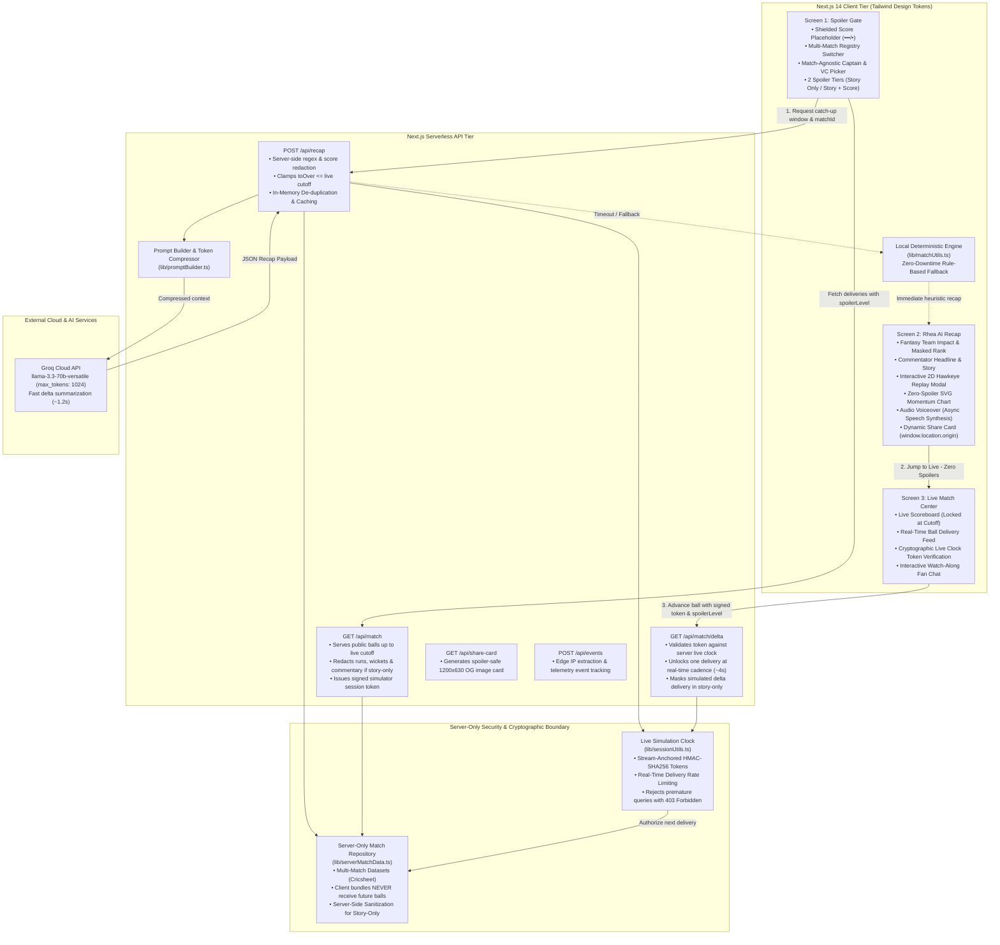

# 🏏 CatchUp AI — "Zero-Spoiler" Live Contextual Time-Machine
> **Product Promise:** *Rejoin a live match in 45 seconds, without being spoiled, and know how your fantasy team did.*  
> **Live Artifact:** [https://dream11-wheat.vercel.app](https://dream11-wheat.vercel.app)  
> **Evaluation Scorecard:** See [EVAL.md](./EVAL.md) (100% pass rate) | **Changelog:** [CHANGELOG.md](./CHANGELOG.md)

---

## 🎯 The Fan Problem
Cricket fans frequently tune into live matches 30–45 minutes late due to office meetings, commutes, or family dinners. When opening sports apps or broadcast feeds, they face a broken experience:
1. **Instant Spoilers:** The app immediately exposes the live scoreline, wickets, and run rate on the home screen, extinguishing all suspense and dramatic tension.
2. **Context Void & Wall-of-Text Fatigue:** Catching up requires scrolling through 10+ overs of dense, dry commentary with zero storytelling. Full video highlights aren't edited or uploaded until hours after the match concludes.
3. **Fantasy Blindspot:** Fans have no quick way to know how their Dream11 Captain (2x) and Vice-Captain (1.5x) performed during the missed phase or where their contest rank stands.

---

## ⚡ The Solution: CatchUp AI
**CatchUp AI** is an interactive, zero-spoiler second-screen companion integrated into Dream11's match experience (Rhea AI & FanCode streaming):

```
[Screen 1: Spoiler Gate] ──▶ [Screen 2: Rhea AI Delta Recap] ──▶ [Screen 3: Live Match Center]
   (Score shielded,             (Commentator headline,              (Unmasked live score,
    Dynamic match selector,      fantasy team impact & rank,         simulated delivery ticker,
    Match-agnostic squad picks,  curated key moments, audio voice,   cryptographic live clock,
    2 spoiler tiers)             interactive Hawkeye & share card)   interactive fan watch-along)
```

1. **Airtight Spoiler Gate:** Masks the live score with a locked `••• / •` shield. Provides 3 phase presets (`Post-Powerplay`, `Middle overs`, `Full match`), 4 time-away chips (`~15 mins`, `~30 mins`, `~45 mins`, `Whole match`), and a dynamic multi-match switcher.
2. **Dream11 Fantasy Team Scoring:** Fans select their Captain (2x) and Vice-Captain (1.5x) from the real match XI roster. Rhea AI scores their fantasy performance during the missed window with dynamic rank movement calculations.
3. **Contextual Delta-Recap:** Powered by **Groq (`llama-3.3-70b-versatile` / `llama-3.1-8b-instant`)** with 1024-token capacity, synthesizing a 45-second personalized breakdown with mood, commentary, and curated turning points.
4. **In-Browser Audio Commentary:** 1-tap synthesized audio voiceover in English (prioritizing native Indian English accents `en-IN` like Neerja / Ravi / Heera) with asynchronous voice preloading to avoid mobile Safari/Chromium race conditions.
5. **Interactive Win-Probability Chart:** Custom SVG momentum curve with calibrated cricket chase dynamics, stable dot tap details, and delivery classification. In **Story-Only** mode, visual cliff-drops are smoothed into a dampened narrative flow and color-coded event markers are neutralized.
6. **"What to Watch Next" Live Bridge:** Tactical preview detailing the next striker, bowler, required equation, and key matchups before entering the live over.
7. **Interactive 2D Hawkeye Trajectory Simulation:** Pitch map visualizer with crease lines, pitch bounce point, 142.4 km/h speed radar, seam deviation ($1.8^\circ$), and outcome trajectory synced with broadcast timecodes.
8. **Live Watch-Along Fan Chat & Stream Gauge:** Active community discussion with quick cheer chips (`🇮🇳 Come on India!`, `🔥 Big over coming!`, `🛡️ Rotate strike!`), optimistic user messaging, and realistic live audience telemetry (~94,850+ fans streaming).
9. **"You Were Away" Inactivity Detection:** Uses Page Visibility API to detect tab switching, offering an immediate catch-up prompt upon return (with `?timescale=60` demo support).
10. **Zero-Spoiler Share Card:** Generates dynamic OpenGraph cards (`/api/share-card`) and 1-tap Web Share / clipboard links resolved to `window.location.origin` with zero score leaks.

---

## 🔍 What's Real vs Simulated in this Prototype

| Feature | Status | Implementation Details |
|---|---|---|
| **Real Match Data** | **Real** | Real ball-by-ball match data from **Cricsheet** (India vs Pakistan T20 WC 2022 & England vs Pakistan T20 WC Final 2022). |
| **Zero-Spoiler Guarantee** | **Real** | Server isolation prevents future balls from ever shipping over the wire. Gated by HMAC simulator tokens. |
| **Server-Side Story-Only Redaction** | **Real** | Strict zero-digit redaction across deliveries and commentary over `/api/match` and `/api/match/delta`. DevTools Network tab exposes zero scorelines. |
| **Fantasy Team Scoring** | **Real** | Dynamically scores Captain (2x) and Vice-Captain (1.5x) deliveries, milestones, and wickets in the exact missed window using official Dream11 rules. |
| **Audio Voiceover** | **Real** | In-browser Web Speech API with asynchronous voice resolution and Indian English voice preference. |
| **Interactive Fan Chat** | **Real UI & Simulated Community** | Interactive message input and quick cheer chips with responsive community reactions. |
| **2D Hawkeye Replay Simulation** | **Real Physics Simulation** | 2D Hawkeye pitch map & ball trajectory simulator with crease marks, bounce point, and speed telemetry. |
| **Leaderboard Rank** | **Simulated Estimate** | Dynamic rank movement calculation based on window performance; transparently labeled as "(Simulated Contest Estimate)". |

---

## 🏗️ System Architecture & Zero-Spoiler Security



---

## 📂 Project Directory & File Structure

```
dream11/
├── app/                                 # Next.js 14 App Router
│   ├── api/
│   │   ├── events/
│   │   │   └── route.ts                 # POST/GET /api/events: Bounded telemetry & conversion metrics
│   │   ├── match/
│   │   │   ├── route.ts                 # GET /api/match: Serves safe deliveries with story-only sanitization
│   │   │   └── delta/
│   │   │       └── route.ts             # GET /api/match/delta: HMAC-validated delivery ticker stream
│   │   ├── recap/
│   │   │   └── route.ts                 # POST /api/recap: Server-side score redaction, caching & Groq LLM
│   │   └── share-card/
│   │       └── route.tsx                # GET /api/share-card: Generates 1200x630 OG image card
│   ├── globals.css                      # Design tokens, Tailwind base, and dark mode palette
│   ├── layout.tsx                       # Root layout & HTML metadata (Dream11 Theme)
│   └── page.tsx                         # SSR page (initial deliveries empty for zero-spoiler safety)
│
├── components/                          # React Component Library
│   ├── CatchUpFlow.tsx                  # State machine managing screens: gate -> recap -> live
│   ├── charts/
│   │   └── WinProbChart.tsx             # Interactive SVG win-probability curve with score redaction
│   └── screens/
│       ├── SpoilerGate.tsx              # Screen 1: Shielded score, match switcher, Captain/VC picker
│       ├── RecapScreen.tsx              # Screen 2: Fantasy impact, async audio, Hawkeye replay modal
│       └── LiveView.tsx                 # Screen 3: Live match ticker, interactive watch-along chat
│
├── hooks/                               # Custom React Hooks
│   └── useAwayDetector.ts               # Tab visibility inactivity detector with ?timescale support
│
├── lib/                                 # Business Logic & Utility Modules
│   ├── analytics.ts                     # Client-side telemetry tracking helper
│   ├── data/
│   │   ├── eng-pak-2022-t20-wc.json     # Cricsheet deliveries: England vs Pakistan (T20 WC Final 2022)
│   │   └── ind-pak-2022-t20-wc.json     # Cricsheet deliveries: India vs Pakistan (MCG T20 WC 2022)
│   ├── groqClient.ts                    # Sequential Groq client with 1024 token capacity
│   ├── matchUtils.ts                    # Single source of truth: scoring, pacing constants, redaction
│   ├── promptBuilder.ts                 # Token-compressed prompt generator for Groq LLM
│   ├── rateLimit.ts                     # Bounded LRU sliding-window rate limiter
│   ├── serverMatchData.ts               # Server-only multi-match repository & dynamic simulator registry
│   └── sessionUtils.ts                  # Cryptographic HMAC token generation & simulation clock
│
├── scripts/                             # Offline Data & Evaluation Scripts
│   ├── convertCricsheet.mjs             # Conversion pipeline from Cricsheet to normalized schema
│   ├── evalRecaps.mjs                   # Automated accuracy & zero-spoiler evaluation benchmark
│   └── run.mjs                          # Unified cross-runtime script runner (Node 18/20/22+)
│
├── tests/                               # Automated Test Suite
│   └── unit.test.mjs                    # 37 Unit tests running under native Node.js test runner
│
├── types/                               # TypeScript Type Definitions
│   └── index.ts                         # Ball, MatchMeta, RecapPayload, ApiResponse<T>
│
├── CHANGELOG.md                         # Product scope and development roadmap
├── EVAL.md                              # Automated evaluation scorecard
├── next.config.mjs                      # Next.js build configuration
├── package.json                         # Lean project dependencies & unified script commands
├── tailwind.config.ts                   # Tailwind configuration with brand tokens
├── tsconfig.json                        # TypeScript compiler configuration
└── README.md                            # Comprehensive project documentation
```

---

## 🎨 Design System Tokens

- **Background:** `brand-bg` (`#0E1116`)
- **Card Surface:** `brand-surface` (`#161B22`)
- **Dividers & Borders:** `brand-border` (`#262C36`)
- **Primary Accent:** `brand-red` (`#E11D48`)
- **Cricket Event Indicators:**
  - **Wicket:** Rose (`#EF4444`)
  - **Six:** Emerald (`#10B981`)
  - **Four:** Blue (`#3B82F6`)
  - **Dot / Run:** Slate (`#64748B` / `#94A3B8`)
  - **Story-Only Neutral Dot:** Indigo (`#818CF8`)

---

## 🚀 Getting Started

### 1. Clone & Install
```bash
git clone https://github.com/yashhh-23/dream11-catchup-ai.git
cd dream11
npm install
```

### 2. Configure Environment Variables
Create `.env.local` in the project root:
```env
GROQ_API_KEY=gsk_your_groq_api_key_here
SESSION_SECRET=your_secure_random_session_secret_min_32_chars_here
ADMIN_SECRET=your_admin_secret_for_events_telemetry_here
```
*(Note: If no Groq API key is provided, the application gracefully activates the local deterministic momentum engine, ensuring 100% demo uptime).*

### 3. Run Development Server
```bash
npm run dev
```
Open [http://localhost:3000](http://localhost:3000) in your browser.

### 4. Run Automated Unit Tests & Evaluation Suite
```bash
# Run 37 unit tests covering security, crypto tokens, range slicing, fantasy points & guardrails
npm test

# Run accuracy evaluation matrix across multiple match phases & modes
npm run eval
```
The evaluation report is automatically generated at [`EVAL.md`](./EVAL.md).

---

## 📊 Data Attribution
- **Ball-by-Ball Match Feed:** Sourced from **[Cricsheet](https://cricsheet.org/)** under the [Open Data Commons Open Database License (ODbL)](https://opendatacommons.org/licenses/odbl/).
- **Matches Available in Registry:**
  1. ICC Men's T20 World Cup 2022 — India vs Pakistan (Melbourne Cricket Ground, 23 October 2022).
  2. ICC Men's T20 World Cup Final 2022 — England vs Pakistan (Melbourne Cricket Ground, 13 November 2022).

---